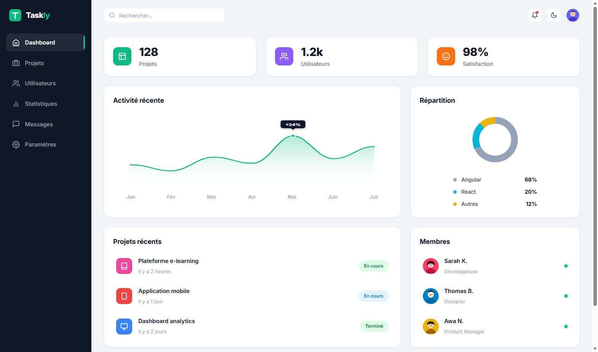

# Taskly – Tableau de bord SaaS & Gestion de projets



**Taskly** est une interface moderne, intuitive et 100% responsive développée avec **Angular** pour le **LibraryUI Challenge**.
Elle reproduit fidèlement la maquette officielle du défi (sidebar sombre, indicateurs clés, graphique d'activité avec infobulle interactive, diagramme de répartition, liste des projets récents et membres d'équipe) tout en intégrant et valorisant 4 composants phares de **LibraryUI**.

- **Démo en ligne** : [https://davidatse.github.io/libraryui/](https://davidatse.github.io/libraryui/)
- **Dépôt GitHub** : [https://github.com/DavidAtse/libraryui](https://github.com/DavidAtse/libraryui)

---

## 4 Composants LibraryUI intégrés

Les 4 composants proviennent directement de [LibraryUI](https://www.libraryui.com) et sont structurés dans [`src/app/libraryui`](src/app/libraryui) :

| N° | Composant LibraryUI | Répertoire source | Utilisation dans l'application |
|---|---|---|---|
| 1 | **Navbar 9** (`app-navbar-9`) | `src/app/libraryui/navbar-9` | Système de navigation supérieur complet avec dropdowns, barre de sous-catégories, logo vectoriel adaptatif et filtres rapides. Accessible également via la route `/navbar`. |
| 2 | **Table / Ship Table** (`app-project-table`) | `src/app/libraryui/project-table` | Tableau interactif sur la page **Projets** (`/projects`) : recherche en direct, filtrage par statut, tri multi-colonnes, pagination, sélection multiple et suppression avec Undo. |
| 3 | **Settings Profile** (`app-settings-profile`) | `src/app/libraryui/settings-profile` | Page **Paramètres** (`/settings`) : édition de profil, téléversement d'avatar, coordonnées d'entreprise, bascule thème clair/sombre et préférences de notifications. |
| 4 | **Contact Mavix** (`app-contact-mavix`) | `src/app/libraryui/contact-mavix` | Page **Messages & Support** (`/messages`) : formulaire de contact moderne avec coordonnées, validation des entrées et accusé d'envoi. |

---

## Fonctionnalités et Vue du Tableau de bord (Dashboard)

1. **Barre latérale (Sidebar) sombre `#111827`** :
   * Logo **LibraryUI** avec icône verte stylisée.
   * Navigation vers `Dashboard`, `Projets`, `Utilisateurs`, `Statistiques`, `Messages`, `Paramètres`.
   * Indicateur actif dynamique avec onglet vertical émeraude.
   * Mode off-canvas responsive avec bouton de fermeture sur mobile et tablette.

2. **En-tête supérieur (Topbar)** :
   * Barre de recherche avec icône loupe et redirection automatique vers les projets.
   * Cloche de notifications avec pastille d'alerte.
   * Bouton bascule de thème sombre / clair en un clic.
   * Avatar utilisateur cliquable menant aux réglages de profil.

3. **Indicateurs clés (KPIs)** :
   * `128` Projets (icône émeraude `#10b981`).
   * `1.2k` Utilisateurs (icône violette `#8b5cf6`).
   * `98%` Satisfaction (icône orange `#f97316`).

4. **Section Graphiques** :
   * **Activité récente** : courbe spline avec dégradé émeraude translucide, axes mensuels (Jan à Juil) et infobulle flottante sombre `+24%` sur le pic de Mai.
   * **Répartition** : diagramme circulaire en anneau (donut chart) avec légende précise (*Angular 68%*, *React 20%*, *Autres 12%*).

5. **Listes récentes** :
   * **Projets récents** : fiches projets interactives avec badges de statuts (*En cours*, *Terminé*) et icônes thématiques.
   * **Membres** : liste de l'équipe (*Sarah K.*, *Thomas B.*, *Awa N.*) avec rôles et pastilles de présence en ligne.

---

## Installation et Lancement local

```bash
# 1. Cloner le projet
git clone https://github.com/DavidAtse/libraryui.git
cd libraryui

# 2. Installer les dépendances
npm install

# 3. Lancer en local
npm start
```

Rendez-vous sur [http://localhost:4200](http://localhost:4200).

---

## Déploiement

Le projet se compile avec la commande :

```bash
npm run build
```

Le workflow GitHub Actions [`.github/workflows/deploy.yml`](.github/workflows/deploy.yml) déploie automatiquement les fichiers de `dist/taskly/browser` vers **GitHub Pages** à chaque mise à jour de la branche `main`.
